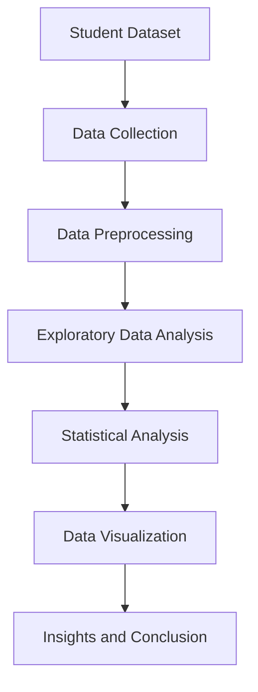

# 📊 Student Performance Analysis

\

## 📌 Project Overview

Student Performance Analysis is a data analytics project designed to analyze students' academic performance and identify factors that influence their academic outcomes.

The project uses data preprocessing, Exploratory Data Analysis (EDA), and data visualization techniques to discover meaningful patterns, relationships, and trends in student performance.

## 🎯 Objectives

- Analyze students' academic performance.
- Identify factors influencing academic results.
- Discover patterns and trends in student data.
- Visualize academic performance using graphical representations.
- Generate meaningful insights to support educational decision-making.

## ✨ Key Features

- **Data Preprocessing:** Cleaning and preparing student datasets for analysis.
- **Exploratory Data Analysis:** Identifying patterns, trends, and relationships.
- **Performance Analysis:** Evaluating students' academic scores and outcomes.
- **Statistical Analysis:** Understanding the distribution and relationship of variables.
- **Data Visualization:** Representing insights through charts and graphs.
- **Insight Generation:** Identifying factors that may influence student performance.

## 🛠️ Tech Stack

| Technology         | Purpose                        |
| ------------------ | ------------------------------ |
| Python             | Programming language           |
| Pandas             | Data manipulation and analysis |
| NumPy              | Numerical computations         |
| Matplotlib         | Data visualization             |
| Visual Studio Code | Development environment        |

## ⚙️ Project Workflow

## 📊 Data Analysis and Visualization

The project explores student performance through techniques such as:

- Bar charts
- Histograms
- Box plots
- Scatter plots
- Correlation analysis
- Performance comparison

These visualizations help identify academic performance patterns and relationships between different variables.

## 🌐 Applications

- Educational institutions.
- Student academic performance monitoring.
- Educational data analytics.
- Academic improvement planning.
- Data-driven educational decision-making.

## 📚 Learning Outcomes

- Data cleaning and preprocessing.
- Exploratory Data Analysis (EDA).
- Statistical analysis.
- Data visualization techniques.
- Interpretation of real-world datasets.
- Analytical and problem-solving skills.

## 🚀 Future Enhancements

- Student performance prediction using Machine Learning.
- Identification of academically at-risk students.
- Interactive performance dashboards.
- Personalized academic recommendations.
- Real-time student performance monitoring.

## 👩‍💻 Developer

**Kiruthika Loganathan**

- B.Tech – Artificial Intelligence and Data Science
- KPR Institute of Engineering and Technology
- GitHub: [kiruthika569](https://github.com/kiruthika569)

---

⭐ If you find this project useful, consider giving the repository a star!

**Student Performance Analysis – Transforming Educational Data into Meaningful Insights.**
